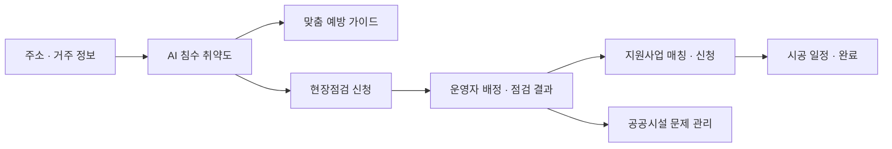
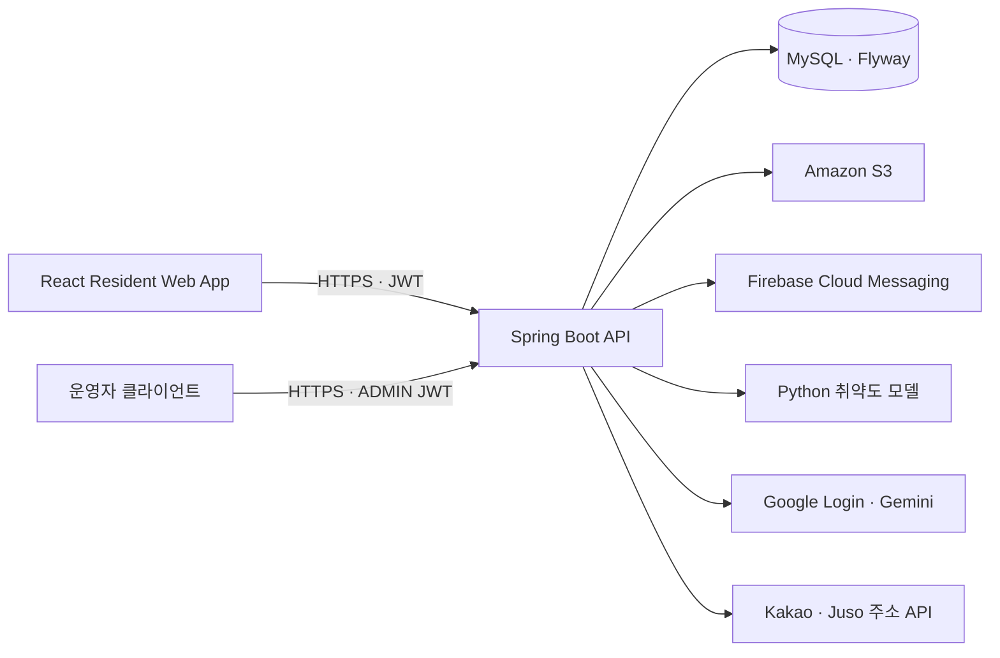
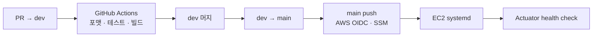

<div align="center">

# 🌊 FLOUT · Server

**부천시 반지하 주민을 위한 침수 예방 서비스 API**

<br/>


<br/>

파일럿 지역 **경기도 부천시** · [Resident Web App](https://github.com/CUK-FLOUT/flout-resident-webapp)

</div>

<br/>

## 📌 목차

1. [서비스 소개](#서비스-소개)
2. [시스템 아키텍처](#시스템-아키텍처)
3. [핵심 기능](#핵심-기능)
4. [API 구성](#api-구성)
5. [프로젝트 구조](#프로젝트-구조)
6. [로컬 실행](#로컬-실행)
7. [테스트와 배포](#테스트와-배포)
8. [문서](#문서)

<br/>

<a id="서비스-소개"></a>

## 🗺️ 서비스 소개

FLOUT Server는 주소 기반 침수 취약도 분석부터 예방 가이드, 현장점검, 지원사업, 시공, 공공시설 문제 관리까지의 전 과정을 연결하는 Spring Boot API 서버입니다. 주민 API와 부천시 관할 운영자 API를 JWT 역할과 관할 기준으로 분리합니다.



<br/>

<a id="시스템-아키텍처"></a>

## 🏗️ 시스템 아키텍처



- JPA 스키마는 `validate`로 검증하며, 변경은 `src/main/resources/db/migration` 의 Flyway SQL로 적용합니다.
- 첨부파일은 비공개 S3 객체로 저장하고 조회 시 서명 URL을 발급합니다.
- FCM 발송 이력과 인앱 알림을 DB에 기록하여 진행 상태 변경을 전달합니다.

<br/>

<a id="핵심-기능"></a>

## 🔍 핵심 기능

- **인증·인가** · 이메일/Google 로그인, Access/Refresh Token 회전, 로그아웃, 관할 기반 운영자 권한
- **취약도·예방** · Python 모델 추론, Gemini 맞춤 예방 가이드, 실천 상태 관리
- **현장점검** · 신청 임시저장, 멱등 첨부, 우선점검 선정, 배정, 결과 임시저장·공개
- **지원·시공** · 지원사업 AI 매칭, 서류 접수, 승인·반려, 시공 배정·일정·사진·완료
- **운영·알림** · 공공시설 문제와 조치 이력 관리, FCM·인앱 알림

<br/>

<a id="api-구성"></a>

## 🔌 API 구성

| 영역 | 대표 경로 | 모듈 |
| --- | --- | --- |
| 인증·회원 | `/api/auth/**`, `/api/admin/me` | `user` |
| 주소·취약도 | `/api/resident/addresses/**`, `/api/resident/risk-assessments/**` | `address`, `riskassessment` |
| 예방 가이드 | `/api/resident/prevention-guides/**`, `/api/resident/guide-items/**` | `preventionguide` |
| 현장점검 신청 | `/api/resident/applications/**`, `/api/admin/applications/**` | `inspectionapplication` |
| 점검·우선점검 | `/api/admin/inspections/**`, `/api/admin/priority-inspections/**` | `inspection`, `priorityinspection` |
| 지원사업 | `/api/resident/support-applications/**`, `/api/admin/support-applications/**` | `supportapplication`, `supportprogram` |
| 시공 | `/api/resident/constructions/**`, `/api/admin/constructions/**` | `construction` |
| 공공시설 문제 | `/api/admin/public-issues/**`, `/api/admin/map/public-issues` | `publicissue` |
| 진행 현황·알림 | `/api/resident/progress`, `/api/resident/notifications/**` | `residentprogress`, `notification` |

실행 중인 서버의 전체 스키마와 응답 예시는 Swagger UI에서, 기능별 처리 규칙과 오류 코드는 [문서 인덱스](docs/README.md)에서 확인할 수 있습니다.

<br/>

<a id="프로젝트-구조"></a>

## 📁 프로젝트 구조

```text
src/
├── main/
│   ├── java/com/flout/server/
│   │   ├── domain/
│   │   │   ├── address/                 # 주소 검색·좌표
│   │   │   ├── construction/            # 시공
│   │   │   ├── inspection/              # 점검 배정·결과
│   │   │   ├── inspectionapplication/   # 현장점검 신청
│   │   │   ├── notification/            # FCM·인앱 알림
│   │   │   ├── preventionguide/         # 맞춤 예방 가이드
│   │   │   ├── priorityinspection/       # 우선점검 선정
│   │   │   ├── publicissue/              # 공공시설 문제
│   │   │   ├── residentprogress/         # 주민 진행 현황·임시저장
│   │   │   ├── riskassessment/           # AI 취약도
│   │   │   ├── supportapplication/       # 지원 신청·매칭
│   │   │   ├── supportprogram/           # 지원사업 정보
│   │   │   └── user/                     # 인증·회원·동의
│   │   └── global/                            # 설정·보안·공통 응답·시간
│   └── resources/
│       ├── db/migration/                          # Flyway SQL
│       └── application*.yml                      # 공통·환경별 설정
└── test/                                      # 단위·통합·마이그레이션 테스트
```

각 도메인은 필요에 따라 `controller`, `service`, `repository`, `entity`, `dto`, `response`, `client`, `config` 하위 패키지로 구성됩니다.

<br/>

<a id="로컬-실행"></a>

## 🛠️ 로컬 실행

Java 21과 Docker Desktop이 필요합니다.

```bash
test -f .env || cp .env.example .env
openssl rand -base64 32 # 출력값을 .env의 JWT_SECRET에 추가
./scripts/run-local.sh
```

`run-local.sh`는 `.env`를 로드하고 MySQL 8.4 health check 후 `local` 프로필로 Spring Boot를 실행합니다.

| 항목 | 주소 |
| --- | --- |
| Swagger UI | `http://localhost:8080/swagger-ui/index.html` |
| OpenAPI JSON | `http://localhost:8080/v3/api-docs` |
| Health check | `http://localhost:8080/actuator/health` |

<details>
<summary><b>주요 환경 변수</b></summary>

| 분류 | 변수 | 용도 |
| --- | --- | --- |
| DB | `DB_HOST`, `DB_PORT`, `DB_NAME`, `DB_USERNAME`, `DB_PASSWORD` | MySQL 연결 |
| 인증 | `JWT_SECRET`, `JWT_ACCESS_TOKEN_SECONDS`, `JWT_REFRESH_TOKEN_SECONDS` | JWT 서명·만료 |
| Google | `GOOGLE_CLIENT_IDS` | Google ID Token 검증 |
| 주소 | `KAKAO_REST_API_KEY`, `JUSO_CONFIRM_KEY` | 주소 검색·좌표 |
| 파일 | `AWS_REGION`, `AWS_S3_BUCKET` | 비공개 첨부파일 저장 |
| 알림 | `GOOGLE_APPLICATION_CREDENTIALS`, `FIREBASE_PROJECT_ID`, `FCM_ENABLED` | Firebase Admin SDK·FCM |
| AI | `AI_MODEL_BASE_URL`, `AI_MODEL_PREDICT_PATH` | Python 취약도 추론 API |
| Gemini | `GEMINI_API_KEY`, `GEMINI_MODEL` | 예방 가이드·지원사업 매칭 |
| Web | `CORS_ALLOWED_ORIGINS` | 허용할 프론트엔드 origin |

`JWT_SECRET`은 32바이트 이상의 Base64 키여야 합니다. 실제 키·토큰·자격 증명 JSON은 저장소에 커밋하지 않습니다.

</details>

- 서버 종료: 실행 터미널에서 `Ctrl+C`
- MySQL 종료: `docker compose down`
- Windows IntelliJ: Docker Desktop에서 MySQL을 실행한 뒤 Spring Boot 구성에 `.env`의 값을 등록하고 `local` 프로필로 실행

<br/>

<a id="테스트와-배포"></a>

## ✅ 테스트와 배포

```bash
./gradlew test          # Spotless 검사 후 전체 테스트
./gradlew clean build   # 클린 빌드
./gradlew spotlessApply # Java·Markdown·YAML 포맷 적용
./gradlew spotlessCheck # 포맷 검사
```



API 변경 시 구현, Swagger/OpenAPI, 테스트, `docs/` 문서를 같은 PR에서 갱신합니다. 작업 규칙은 [CONTRIBUTING.md](CONTRIBUTING.md), OIDC·EC2·HTTPS·복구 절차는 [EC2 배포 문서](docs/EC2_DEPLOYMENT.md)를 참고하세요.

<br/>

<a id="문서"></a>

## 📚 문서

- [기능·API 문서 인덱스](docs/README.md)
- [기여 가이드](CONTRIBUTING.md)
- [AI 취약도 모델 파이프라인](docs/AI_MODEL_PIPELINE.md)
- [EC2 배포 가이드](docs/EC2_DEPLOYMENT.md)

<br/>

<div align="center">
  <sub>🌊 비가 오기 전에, 우리 집 반지하부터.</sub>
</div>
