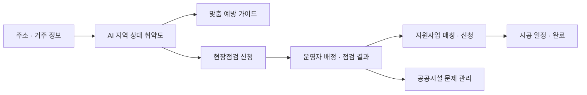
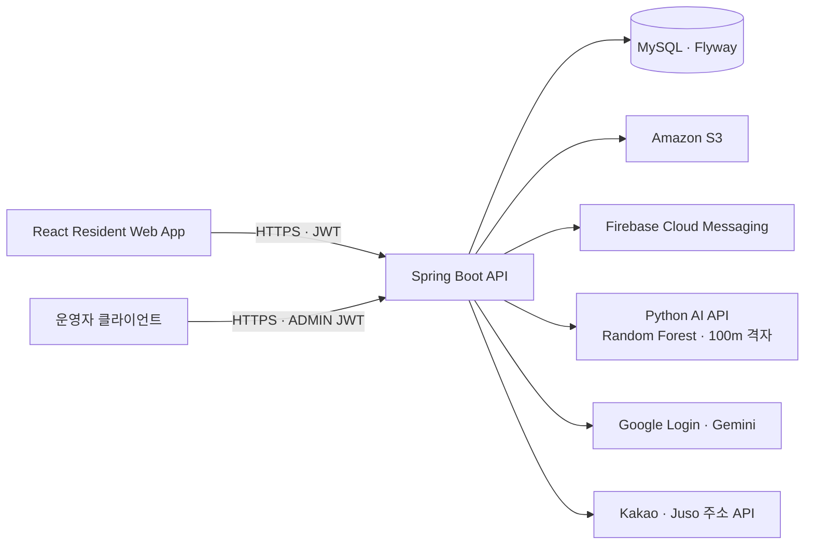
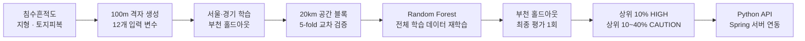
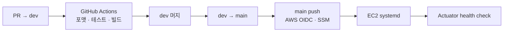

<div align="center">

# 🌊 FLOUT · Server

**부천시 반지하 주민을 위한 침수 예방 서비스 API**

<br/>


<br/>

파일럿 지역 **경기도 부천시** · [Resident Web App](https://github.com/CUK-FLOUT/flout-resident-webapp)

</div>

<br/>

## 📌 목차

1. [서비스 소개](#서비스-소개)
2. [시스템 아키텍처](#시스템-아키텍처)
3. [핵심 기능](#핵심-기능)
4. [AI 지역 상대 취약도 모델](#ai-지역-상대-취약도-모델)
5. [API 구성](#api-구성)
6. [개발자와 역할](#개발자와-역할)
7. [프로젝트 구조](#프로젝트-구조)
8. [로컬 실행](#로컬-실행)
9. [테스트와 배포](#테스트와-배포)
10. [문서](#문서)

<br/>

<a id="서비스-소개"></a>

## 🗺️ 서비스 소개

FLOUT Server는 주소 기반 침수 취약도 분석부터 예방 가이드, 현장점검, 지원사업, 시공, 공공시설 문제 관리까지의 전 과정을 연결하는 Spring Boot API 서버입니다. 주민 API와 부천시 관할 운영자 API를 JWT 역할과 관할 기준으로 분리합니다.



<br/>

<a id="시스템-아키텍처"></a>

## 🏗️ 시스템 아키텍처



- JPA 스키마는 `validate`로 검증하며, 변경은 `src/main/resources/db/migration` 의 Flyway SQL로 적용합니다.
- 첨부파일은 비공개 S3 객체로 저장하고 조회 시 서명 URL을 발급합니다.
- FCM 발송 이력과 인앱 알림을 DB에 기록하여 진행 상태 변경을 전달합니다.
- Spring 서버는 주소를 좌표로 변환한 뒤 Python API의 사전 계산된 100m 격자 결과를 조회하며, 모델 파일과 등급 경계값은 Python 배포 환경에서 관리합니다.

<br/>

<a id="핵심-기능"></a>

## 🔍 핵심 기능

- **인증·인가** · 이메일/Google 로그인, Access/Refresh Token 회전, 로그아웃, 관할 기반 운영자 권한
- **취약도·예방** · Random Forest 기반 지역 상대 취약도 분석, Gemini 맞춤 예방 가이드, 실천 상태 관리
- **현장점검** · 신청 임시저장, 멱등 첨부, 우선점검 선정, 배정, 결과 임시저장·공개
- **지원·시공** · 지원사업 AI 매칭, 서류 접수, 승인·반려, 시공 배정·일정·사진·완료
- **운영·알림** · 공공시설 문제와 조치 이력 관리, FCM·인앱 알림

<br/>

<a id="ai-지역-상대-취약도-모델"></a>

## 🧠 AI 지역 상대 취약도 모델

FLOUT의 AI 모델은 입력 주소가 속한 **100m 격자의 지형·토지피복 조건이 과거 침수
지역과 얼마나 유사한지**를 0~1 점수로 산출합니다. 이 점수는 개별 주택의 침수 확률이나
안전 판정이 아니며, 서비스에서는 부천시 내 상대 순위에 따라 `HIGH`, `CAUTION`, `LOW`로
표시합니다.



### 데이터와 입력 변수

| 데이터 | 출처 | 모델 활용 |
| --- | --- | --- |
| 침수흔적도 | 행정안전부 재난안전데이터 공유플랫폼 오픈 API, 2002~2022 | 격자별 침수 기록 정답 |
| 지표면 높이 | Copernicus DEM GLO-30 | 높이·경사·주변 대비 높이·움푹한 지형 여부 |
| 토지피복 | ESA WorldCover 2021 v200 | 건물·도로·녹지·농지·맨땅·물 비율과 물까지 거리 |
| 도시침수지도 | 한강홍수통제소 부천 100년 빈도 | 모델 입력에서 제외하고 결과 비교에만 사용 |

모델 입력은 `elev`, `slope`, `rel_elev_500`, `rel_elev_1k`, `sink`, `built`,
`built_500`, `green`, `crop`, `bare`, `water`, `dist_water`의 12개 변수입니다.
위도·경도와 침수 연도·깊이·겹친 기록 수는 위치 암기와 데이터 누수를 막기 위해 입력에서
제외합니다.

### 학습과 공간 검증

- 서울·경기 438,087개 격자 중 침수 기록 7,170개를 학습에 사용했습니다.
- 부천 일대 7,832개 격자와 침수 기록 151개는 학습에서 완전히 분리한 홀드아웃으로
  유지했으며, 경계 누수를 줄이기 위해 주변 1km 격자도 학습에서 제외했습니다.
- 일반 무작위 분할 대신 인접 지역의 공간 자기상관을 고려한 20km 블록
  `GroupKFold(5)`로 검증했습니다.
- 침수 격자가 약 1.6%인 불균형 데이터이므로 정확도 대신 `PR-AUC`, 상위 10% 포착률,
  `ROC-AUC`, 구간별 실제 침수율을 평가했습니다.

최종 모델은 `RandomForestClassifier` 1개이며 주요 설정은 다음과 같습니다.

| 설정 | 값 | 목적 |
| --- | --- | --- |
| `n_estimators` | `300` | 300개 결정 트리 앙상블 |
| `min_samples_leaf` | `10` | 지나치게 작은 잎 방지 |
| `max_features` | `sqrt` | 트리별 변수 부분 선택 |
| `max_samples` | `0.3` | 트리별 데이터 30% 표본 사용 |
| `class_weight` | `balanced_subsample` | 희소한 침수 격자 가중치 보정 |
| `random_state` | `0` | 재현 가능한 학습 |

### 평가 결과와 화면 표시

| 평가 구간 | PR-AUC | ROC-AUC | 주요 결과 |
| --- | ---: | ---: | --- |
| 서울·경기 공간 검증 | 0.069 (무작위 0.016) | 0.813 | HIGH와 LOW의 실제 침수율 18.3배 차이 |
| 부천 홀드아웃 | 0.088 (무작위 0.019) | 0.775 | 상위 10%가 침수 격자의 36.4% 포착, HIGH와 LOW 14.6배 차이 |

| 표시 등급 | 상대 순위 | 점수 경계 |
| --- | --- | ---: |
| `HIGH` | 검증 점수 상위 10% | `score >= 0.1905` |
| `CAUTION` | 상위 10~40% | `0.0475 <= score < 0.1905` |
| `LOW` | 나머지 60% | `score < 0.0475` |

부천 홀드아웃에서 실제 침수 격자의 95.4%가 `CAUTION` 이상에 포함됐습니다. 서비스는
`HIGH`를 “침수 위험 확정”이 아닌 “주의가 필요한 동네”로 안내하고, 침수 기록이 없다는
표시도 안전을 의미하지 않는다고 명시합니다. 침수흔적도의 시기·지역 편향, 30m DEM과
100m 격자의 해상도, 부천 침수 표본 151개의 한계가 있으므로 모델 결과는 현장점검과
예방 행동을 돕는 참고 정보로만 사용합니다.

Spring 서버는 Python 서비스의
`GET /api/vulnerability?lat={latitude}&lon={longitude}`를 호출하고, 격자 ID·점수·등급·
침수 기록 안내·주의 문구를 검증한 뒤 저장합니다. 조회 가능한 격자가 없으면 가장 가까운
값으로 대체하지 않고 분석 불가로 처리합니다.

<br/>

<a id="api-구성"></a>

## 🔌 API 구성

| 영역 | 대표 경로 | 모듈 |
| --- | --- | --- |
| 인증·회원 | `/api/auth/**`, `/api/admin/me` | `user` |
| 주소·취약도 | `/api/resident/addresses/**`, `/api/resident/risk-assessments/**` | `address`, `riskassessment` |
| 예방 가이드 | `/api/resident/prevention-guides/**`, `/api/resident/guide-items/**` | `preventionguide` |
| 현장점검 신청 | `/api/resident/applications/**`, `/api/admin/applications/**` | `inspectionapplication` |
| 점검·우선점검 | `/api/admin/inspections/**`, `/api/admin/priority-inspections/**` | `inspection`, `priorityinspection` |
| 지원사업 | `/api/resident/support-applications/**`, `/api/admin/support-applications/**` | `supportapplication`, `supportprogram` |
| 시공 | `/api/resident/constructions/**`, `/api/admin/constructions/**` | `construction` |
| 공공시설 문제 | `/api/admin/public-issues/**`, `/api/admin/map/public-issues` | `publicissue` |
| 진행 현황·알림 | `/api/resident/progress`, `/api/resident/notifications/**` | `residentprogress`, `notification` |

실행 중인 서버의 전체 스키마와 응답 예시는 Swagger UI에서, 기능별 처리 규칙과 오류 코드는 [문서 인덱스](docs/README.md)에서 확인할 수 있습니다.

<br/>

<a id="개발자와-역할"></a>

## 👩‍💻 개발자와 역할

| 개발자 | 역할 및 주요 담당 영역 |
| --- | --- |
| [김민지 (@meeeji)](https://github.com/meeeji) | AI 추론·Gemini 연동, 맞춤 예방 가이드, 지원사업 매칭, 공공 인프라 문제·조치, API 문서화 |
| [김희진 (@heejin0283)](https://github.com/heejin0283) | 인증·회원, 현장점검 배정·결과, 우선점검, 시공·알림 흐름, 공통 API 안정화 |
| [하늘 (@leehn04)](https://github.com/leehn04) | 주소 검색·좌표, 주민 현장점검 신청·첨부, 진행 현황, 예방 가이드·지원 신청 주민 흐름 |
| [Daisy Kim (@nin0nee)](https://github.com/nin0nee) | 지원 신청·검토, 현장점검 결과 흐름, 공공 문제 연계 기능과 테스트 |
| [은우 (@Goeunwoo)](https://github.com/Goeunwoo) | 지원 신청 승인·상태 관리, 현장점검 신청·지원 연계, 시공 도메인 기능과 테스트 |

역할은 서버 저장소의 주요 기여 영역을 기준으로 정리했으며, 모든 개발자가 도메인 간
연동·테스트·리뷰에 함께 참여했습니다.

<br/>

<a id="프로젝트-구조"></a>

## 📁 프로젝트 구조

```text
src/
├── main/
│   ├── java/com/flout/server/
│   │   ├── domain/
│   │   │   ├── address/                 # 주소 검색·좌표
│   │   │   ├── construction/            # 시공
│   │   │   ├── inspection/              # 점검 배정·결과
│   │   │   ├── inspectionapplication/   # 현장점검 신청
│   │   │   ├── notification/            # FCM·인앱 알림
│   │   │   ├── preventionguide/         # 맞춤 예방 가이드
│   │   │   ├── priorityinspection/       # 우선점검 선정
│   │   │   ├── publicissue/              # 공공시설 문제
│   │   │   ├── residentprogress/         # 주민 진행 현황·임시저장
│   │   │   ├── riskassessment/           # AI 취약도
│   │   │   ├── supportapplication/       # 지원 신청·매칭
│   │   │   ├── supportprogram/           # 지원사업 정보
│   │   │   └── user/                     # 인증·회원·동의
│   │   └── global/                            # 설정·보안·공통 응답·시간
│   └── resources/
│       ├── db/migration/                          # Flyway SQL
│       └── application*.yml                      # 공통·환경별 설정
└── test/                                      # 단위·통합·마이그레이션 테스트
```

각 도메인은 필요에 따라 `controller`, `service`, `repository`, `entity`, `dto`, `response`, `client`, `config` 하위 패키지로 구성됩니다.

<br/>

<a id="로컬-실행"></a>

## 🛠️ 로컬 실행

Java 21과 Docker Desktop이 필요합니다.

```bash
test -f .env || cp .env.example .env
openssl rand -base64 32 # 출력값을 .env의 JWT_SECRET에 추가
./scripts/run-local.sh
```

`run-local.sh`는 `.env`를 로드하고 MySQL 8.4 health check 후 `local` 프로필로 Spring Boot를 실행합니다.

| 항목 | 주소 |
| --- | --- |
| Swagger UI | `http://localhost:8080/swagger-ui/index.html` |
| OpenAPI JSON | `http://localhost:8080/v3/api-docs` |
| Health check | `http://localhost:8080/actuator/health` |

<details>
<summary><b>주요 환경 변수</b></summary>

| 분류 | 변수 | 용도 |
| --- | --- | --- |
| DB | `DB_HOST`, `DB_PORT`, `DB_NAME`, `DB_USERNAME`, `DB_PASSWORD` | MySQL 연결 |
| 인증 | `JWT_SECRET`, `JWT_ACCESS_TOKEN_SECONDS`, `JWT_REFRESH_TOKEN_SECONDS` | JWT 서명·만료 |
| Google | `GOOGLE_CLIENT_IDS` | Google ID Token 검증 |
| 주소 | `KAKAO_REST_API_KEY`, `JUSO_CONFIRM_KEY` | 주소 검색·좌표 |
| 파일 | `AWS_REGION`, `AWS_S3_BUCKET` | 비공개 첨부파일 저장 |
| 알림 | `GOOGLE_APPLICATION_CREDENTIALS`, `FIREBASE_PROJECT_ID`, `FCM_ENABLED` | Firebase Admin SDK·FCM |
| AI | `AI_MODEL_BASE_URL`, `AI_MODEL_PREDICT_PATH` | Python 취약도 추론 API |
| Gemini | `GEMINI_API_KEY`, `GEMINI_MODEL` | 예방 가이드·지원사업 매칭 |
| Web | `CORS_ALLOWED_ORIGINS` | 허용할 프론트엔드 origin |

`JWT_SECRET`은 32바이트 이상의 Base64 키여야 합니다. 실제 키·토큰·자격 증명 JSON은 저장소에 커밋하지 않습니다.

</details>

- 서버 종료: 실행 터미널에서 `Ctrl+C`
- MySQL 종료: `docker compose down`
- Windows IntelliJ: Docker Desktop에서 MySQL을 실행한 뒤 Spring Boot 구성에 `.env`의 값을 등록하고 `local` 프로필로 실행

<br/>

<a id="테스트와-배포"></a>

## ✅ 테스트와 배포

```bash
./gradlew test          # Spotless 검사 후 전체 테스트
./gradlew clean build   # 클린 빌드
./gradlew spotlessApply # Java·Markdown·YAML 포맷 적용
./gradlew spotlessCheck # 포맷 검사
```



API 변경 시 구현, Swagger/OpenAPI, 테스트, `docs/` 문서를 같은 PR에서 갱신합니다. 작업 규칙은 [CONTRIBUTING.md](CONTRIBUTING.md), OIDC·EC2·HTTPS·복구 절차는 [EC2 배포 문서](docs/EC2_DEPLOYMENT.md)를 참고하세요.

<br/>

<a id="문서"></a>

## 📚 문서

- [기능·API 문서 인덱스](docs/README.md)
- [기여 가이드](CONTRIBUTING.md)
- [AI 취약도 모델 파이프라인](docs/AI_MODEL_PIPELINE.md)
- [EC2 배포 가이드](docs/EC2_DEPLOYMENT.md)

<br/>

<div align="center">
  <sub>🌊 비가 오기 전에, 우리 집 반지하부터.</sub>
</div>
