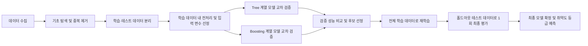

# AI 취약도 분석 모델 파이프라인

> 현재 모델은 설계 단계입니다. 데이터 수집과 탐색적 데이터 분석 이후 입력 변수와
> 후보 모델을 확정할 예정입니다.

## 문제 정의

수집된 지역 및 건축물 정보를 바탕으로 취약도 등급 `HIGH`, `CAUTION`, `LOW`를
예측하는 다중 분류 문제로 정의합니다. 입력 변수는 데이터의 품질, 결측치 및 분포를
확인한 후 선정합니다.

## 모델 개발 파이프라인

1. 침수 이력, 건축물, 지형 및 지역 정보 등 취약도 분석에 필요한 데이터를
   수집합니다.
2. 전체 데이터에서는 스키마 및 값 범위 확인, 클래스 분포 확인, 완전히 동일한
   중복값 제거처럼 데이터에서 파라미터를 학습하지 않는 작업만 수행합니다.
3. 데이터 누수를 방지하기 위해 데이터를 학습 데이터와 홀드아웃 테스트 데이터로
   먼저 분리합니다. 테스트 데이터는 이 시점부터 최종 평가 전까지 사용하지 않습니다.
4. 결측치 대체, 이상치 기준 산정, 인코딩, 스케일링 및 입력 변수 선정처럼 데이터에서
   기준을 학습하는 전처리는 학습 데이터에만 적합합니다. 교차 검증에서는 각 fold의
   학습 부분에만 전처리를 적합하고, 검증 부분에는 학습된 변환을 그대로 적용합니다.
5. Tree 계열 모델 1개와 Boosting 계열 모델 1개를 학습 데이터 내부의 동일한
   교차 검증 조건에서 비교합니다.
6. 아래의 사전 정의된 선정 기준으로 후보 모델을 고정한 뒤 전체 학습 데이터로
   재학습합니다.
7. 고정된 모델과 전처리를 미사용 홀드아웃 테스트 데이터에 한 번만 적용하여 최종
   일반화 성능을 평가합니다. 테스트 결과는 모델 또는 기준을 다시 선택하는 데
   사용하지 않습니다.

후보 모델은 데이터의 크기와 특성을 확인한 후 결정합니다. 예를 들어 Tree 계열에서는
Decision Tree 또는 Random Forest를, Boosting 계열에서는 XGBoost, LightGBM 또는
CatBoost를 검토할 수 있습니다.

## 평가 지표

| 지표 | 용도 |
| --- | --- |
| Macro F1-score | 각 취약도 등급을 동일한 비중으로 평가하는 주요 지표 |
| HIGH Recall | 실제 고위험 대상을 놓치지 않는지 확인하는 안전성 지표 |
| 등급별 Precision·Recall·F1 | 등급마다 발생하는 성능 차이 확인 |
| Confusion Matrix | 등급 간 오분류 양상 확인 |
| Balanced Accuracy | 클래스 불균형을 고려한 보조 지표 |

## 최종 모델 선정 기준

아래 기준은 홀드아웃 테스트 결과를 확인하기 전에 고정하며, 모델 비교에는 학습 데이터
내 교차 검증 결과만 사용합니다.

1. 초기 최소 기준인 평균 `HIGH` Recall 0.90 이상을 충족한 모델만 후보로 둡니다.
   이 수치는 데이터 라벨 정의와 운영상 위험 허용 범위를 검토하여 실험 시작 전에
   최종 확정하며, 실험 결과를 확인한 뒤 유리하게 변경하지 않습니다.
2. 후보 중 평균 Macro F1-score가 가장 높은 모델을 선택합니다.
3. Macro F1-score 차이가 0.005 미만이면 동점으로 보고, 평균 `HIGH` Recall이 더 높은
   모델을 선택합니다.
4. 두 지표도 동점이면 교차 검증 fold 간 Macro F1-score 표준편차가 더 작은 모델을
   선택하고, 이 값까지 같으면 직렬화된 모델 파일 크기가 더 작은 모델을 선택합니다.

## 진행 상태

- [ ] 데이터 수집
- [ ] 데이터 탐색 및 정제
- [ ] 입력 변수 선정
- [ ] Tree 계열 후보 모델 학습
- [ ] Boosting 계열 후보 모델 학습
- [ ] 교차 검증 및 성능 평가
- [ ] 최종 모델 선정
- [ ] 백엔드 추론 API 연동
