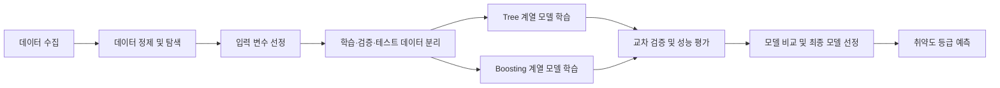

# AI 취약도 분석 모델 파이프라인

> 현재 모델은 설계 단계입니다. 데이터 수집과 탐색적 데이터 분석 이후 입력 변수와
> 후보 모델을 확정할 예정입니다.

## 문제 정의

수집된 지역 및 건축물 정보를 바탕으로 취약도 등급 `HIGH`, `CAUTION`, `LOW`를
예측하는 다중 분류 문제로 정의합니다. 입력 변수는 데이터의 품질, 결측치 및 분포를
확인한 후 선정합니다.

## 모델 개발 파이프라인

1. 침수 이력, 건축물, 지형 및 지역 정보 등 취약도 분석에 필요한 데이터를
   수집합니다.
2. 결측치, 이상치, 중복값과 클래스 분포를 확인하고 데이터를 정제합니다.
3. 데이터 누수를 방지하며 학습·검증·테스트 데이터를 분리합니다.
4. Tree 계열 모델 1개와 Boosting 계열 모델 1개를 동일한 데이터와 검증 조건에서
   학습합니다.
5. 교차 검증 결과와 등급별 성능을 비교하여 최종 모델을 선정합니다.

후보 모델은 데이터의 크기와 특성을 확인한 후 결정합니다. 예를 들어 Tree 계열에서는
Decision Tree 또는 Random Forest를, Boosting 계열에서는 XGBoost, LightGBM 또는
CatBoost를 검토할 수 있습니다.

## 평가 지표

| 지표 | 용도 |
| --- | --- |
| Macro F1-score | 각 취약도 등급을 동일한 비중으로 평가하는 주요 지표 |
| HIGH Recall | 실제 고위험 대상을 놓치지 않는지 확인하는 안전성 지표 |
| 등급별 Precision·Recall·F1 | 등급마다 발생하는 성능 차이 확인 |
| Confusion Matrix | 등급 간 오분류 양상 확인 |
| Balanced Accuracy | 클래스 불균형을 고려한 보조 지표 |

최종 모델은 Macro F1-score를 중심으로 비교하되, 안전상 중요한 `HIGH` 등급의
Recall을 별도로 확인합니다. 취약도 등급을 직접 예측하므로 회귀 지표인 R²와 RMSE는
현재 평가 지표에 포함하지 않습니다.

## 진행 상태

- [ ] 데이터 수집
- [ ] 데이터 탐색 및 정제
- [ ] 입력 변수 선정
- [ ] Tree 계열 후보 모델 학습
- [ ] Boosting 계열 후보 모델 학습
- [ ] 교차 검증 및 성능 평가
- [ ] 최종 모델 선정
- [ ] 백엔드 추론 API 연동
