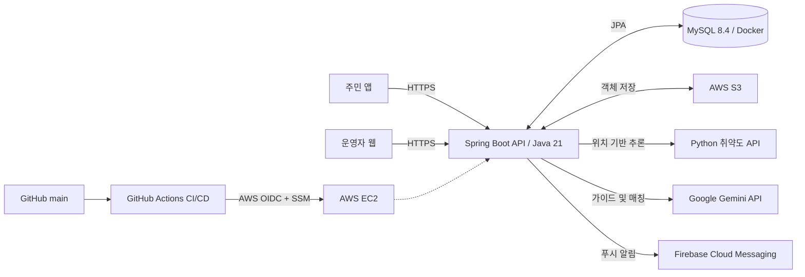

# FLOUT 서버 아키텍처

## 주요 구성

## 책임 및 경계

- **Spring Boot**: 인증/인가, 신청·점검·공공인프라·지원·시공 업무 로직, AI API 연동, 파일 메타데이터 관리.
- **MySQL**: 영속 데이터. 스키마 변경은 Flyway `V*.sql` 순차 적용.
- **S3**: 사진 및 첨부 객체 저장. DB 저장 키와 다운로드용 서명 URL을 구분.
- **Python**: 격자 기반 지역 **상대** 취약도 추론. 절대 침수 확률이 아님.
- **Gemini**: 맞춤 예방 가이드 생성 및 지원사업 매칭. 외부 모델 출력은 서버에서 검증.
- **FCM**: 앱 푸시. 발송 성공과 단말 수신 보장은 다름.
- **배포**: main → GitHub Actions → OIDC/SSM → EC2. 현재 배포 구성은 [EC2_DEPLOYMENT.md](EC2_DEPLOYMENT.md)를 참조.

> **확인 필요**: 네트워크 포트, 프록시, 실제 DB 호스팅 방식 및 서비스별 접속 URL은 배포 환경의 설정이 최종 기준입니다. 아키텍처 도식에 RDS를 임의로 추가하지 않습니다.
